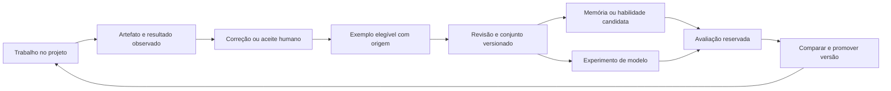

# Criador, Espelho e desenvolvimento da Vyra

Complemento do plano de UX, a partir do [terceiro adendo](ADENDO-3-INTEGRAL.md) e da [definição das quatro IAs](ADENDO-4-INTEGRAL.md). **Proposta para implementação após concordância.** A pasta recebida foi estudada como material; não foi ativada, instalada, executada ou alterada.

**Decisão mais recente:** as quatro opções são **Claude Code, Codex, OpenCode e Vyra**. Vyra pode ser a única IA em uso. Toda atividade do Babel gera substrato para ela; a arquitetura não depende de Python. A integração completa de Vyra ocupa a quarta etapa de integração, anteriormente sem nome.

## 1. Material localizado e o que ele demonstra

| Fonte | Conteúdo observado | Consequência para o Babel |
|---|---|---|
| `/Users/matheussilveirapro/Downloads/criador/CLAUDE.md` | Fonte de identidade, regras, memória, missões e evolução; ainda “Sem Nome” | Aproveitar contratos e preservar identidade por pessoa/agente; importar não renomeia [[Dominic]] ou [[Vyra]] |
| `corpo/instalar.mjs` | Geração para Claude, Gemini, Codex, OpenCode e genérico | Adaptar distribuição por versão/capacidade; três ferramentas iniciais do Babel permanecem Claude Code, Codex e OpenCode |
| `corpo/espelho.html` | Template da apresentação/configuração dos módulos | Base para o novo Espelho, com componentes por capacidade |
| `espelho/index.html` | Template com `RETRATO` JSON incorporado, datado e originado de outra máquina | Snapshot serve como referência; seus números/estados não são medição atual deste Mac |
| `corpo/espelho.mjs` | Lê estado, gera HTML e expõe servidor local; configuração por POST | Separar consulta, apresentação, edição e execução; não importar o servidor como efeito de abrir a página |
| `corpo/config.json`, `corpo/sono.mjs`, `memoria/`, `versoes/` | Busca, consolidação de cartões, protocolos e preservação de versões | Reutilizar conceitos de proveniência, invalidação e retomada; resumir cartões não é treinamento de pesos |
| `/Users/matheussilveirapro/Desktop/Dominic/teste/criador/gemma-vyra/Modelfile.gemma-vyra` | Base `gemma4:12b`, contexto 8192, temperatura 0,2 e instruções de desenvolvimento em português | Candidata concreta para ativação assistida; conferir identificação/digest e integração na execução futura |
| `gemma-vyra/GEMMA-VYRA.md` nessa mesma pasta | Registra alias local já instalado; diz que geração curta de dados `.dom.tsv` foi observada e autoria de `.dom` não comprovada | Não transformar relato anterior em prova desta missão; testar capacidades por contrato antes de ampliar autonomia |

O link do artifact Claude não pôde ser lido pela ferramenta de pesquisa. A análise usa a cópia local indicada pelo Theus; equivalência entre ela e a versão online não foi comprovada.

### Pontos que precisam de adaptação

- O Espelho consulta `python3 --version` na lista de instrumentos (`corpo/espelho.mjs:62–63`) antes de rotular Python como bloqueado. Remover essa invocação do adaptador antes de qualquer execução no Babel. Python permanece proibido, inclusive para sondagem.
- O material contém instruções para despertar, agendar processos e usar subagentes. Elas descrevem aquele pacote; não autorizam essas ações nesta análise. O executor atual continua único.
- O instalador declara compatibilidade com hooks e indica limitações por ferramenta. Compatibilidade efetiva deve ser conferida com as versões instaladas; “arquivo existe” não significa “hook executou”.
- Alguns estados do Espelho derivam da existência de arquivos ou valores fixos. O novo painel precisa distinguir **declarado, configurado, observado e comprovado**, com data e origem.
- `AGENTS.md`/`GEMINI.md` são derivados. A evolução modifica a fonte e gera uma proposta de diferença; não edita derivados manualmente nem sobrescreve instruções globais ou o contrato do projeto.
- O `Modelfile` encontrado carrega a restrição Dominic do projeto de origem. A permissão JS/Node do Babel não se transfere ao projeto Vyra/Dominic. Adaptadores precisam carregar o contrato do destino e validar a linguagem correta.

## 2. S17 · Espelho do Criador — apresentar e operar um corpo que cresce

**Entrada:** Agentes → selecionar agente → Espelho. Biblioteca → Modelos → Criador abre sua apresentação. Uma versão exportável apresenta o sistema sem dados pessoais. A área pode ocupar a janela inteira; não vira mais um ícone permanente na barra principal.

### Direção da página

**Cena inicial:** “Um corpo para construir. Memória para continuar.” Um objeto modular central representa a organização do agente. As regiões Perceber, Lembrar, Agir, Conferir e Evoluir podem ser exploradas por clique e teclado. Um acontecimento percorre o corpo e revela o artefato produzido; a animação conta uma operação compreensível.

**Linguagem visual:** núcleo cerâmico/metal escuro, conexões luminosas contidas e peças com silhuetas distintas; contraste com papel quente no Vibe. Typography e composição dão escala e espaço. Replicate pode produzir conceitos de corpo, materiais, peças e sequências de apresentação. O asset final precisa de malha, materiais, nomes, LOD e licença registrados; nenhum indicador de saúde é embutido na imagem gerada.

**Duas composições do mesmo conteúdo:** Apresentar conta a história em cenas de tela inteira; Operar permite inspecionar módulos, contexto, versões, distribuição e correções. Transmitir usa a composição pública sem expor memória pessoal, configurações ou credenciais.

| Região | O que a pessoa vê/faz |
|---|---|
| Visão do corpo | Função de cada módulo e um exemplo de entrada → ação → resultado |
| Estado atual | Ferramenta/modelo efetivos, tarefa, módulos disponíveis, última observação e limites |
| Memória | Fontes usadas, correções, validade e destino do conhecimento; contagem acompanhada de utilidade demonstrada |
| Distribuições | Claude Code, Codex e OpenCode; comparar pacote, versão, capacidades e instruções propostas |
| Evolução | Versão atual/anterior/candidata; o que mudou, por quê, evidência e restaurar |
| Relatar problema | Esperado, observado, contexto/versão e captura opcional; confirmar o que será anexado |
| Laboratório Vyra | Entrada secundária para casos, avaliações, candidatos e dependência da Gemma |

### Crescer sem refazer a página

Registrar cada módulo por `id`, versão do contrato, título, função, capacidades, dependências, estado, evidência, ações, ícone/asset e seção. O layout renderiza esse registro. Adicionar um órgão exige declarar sua função e conexão; não duplicar páginas ou esconder nova lógica em HTML concatenado.

Componentes separados: cena de apresentação; mapa do corpo; detalhe do módulo; linha do tempo; distribuição; relato; comparação de versões. Dados consultados por adaptador; comandos usam o registro de ações do Babel. Exportação estática traz data, versão e rótulo “retrato”; modo ao vivo exibe origem e desconexão real. Campos de configuração têm validação, diferença antes/depois e resposta do servidor.

**Ciclo de melhoria em campo:** Theus relata → reproduzir com versão/estado → classificar → tarefa ligada ao módulo → correção candidata → avaliação de regressão → versão publicada → relato resolvido com prova. Rascunho do relato sobrevive a uma queda; erro de UI pode ser reportado sem o próprio agente funcionar. Nada é declarado corrigido apenas porque o botão de fechar foi pressionado.

## 3. Inicializar os agentes com o Criador

O pacote inicial combina **núcleo do Criador + contrato do projeto + pessoa/agente + tarefa + adaptador da ferramenta**. Identidade, memória pessoal, memória do projeto e conhecimento compartilhável têm destinos distintos.

1. Ler a fonte e registrar versão/hash dos arquivos selecionados, sem copiar bases pessoais para todos.
2. Conferir capacidades da ferramenta instalada; mostrar ganchos disponíveis, indisponíveis e rotina explícita equivalente.
3. Montar um pacote mínimo com identidade, instruções aplicáveis, objetivo, critérios, contexto, ferramentas e ponto de retomada.
4. Mostrar a diferença em relação à versão ativa; aplicar ao escopo correto quando autorizado.
5. Abrir sessão e comprovar contexto efetivamente recebido, registro de ação, parada e retomada.

O suporte Gemini existente é preservado no catálogo de origem, mas fica fora das quatro opções do Babel. **Theus definiu Vyra como a quarta IA.** Gemma é um modelo; Gemini CLI é outra ferramenta. Vyra é a identidade/sistema que estamos desenvolvendo.

## 4. S18 · Laboratório Vyra — função secundária do Babel

**Entrada:** Espelho → Evolução → Laboratório Vyra; também Preferências → Desenvolvimento. A equipe continua entrando pelo projeto para trabalhar. O laboratório acompanha versões e resultados sem transformar toda tela em painel de treinamento.

**Gemma‑Vyra na ativação:** adaptador explícito para o perfil local encontrado, com iniciar/parar, saúde observada, modelo/digest, capacidade e consumo reais. A primeira ativação monta contexto e executa uma missão pequena em ambiente delimitado. Saídas passam pelo contrato do projeto; dado `.dom.tsv` e programa `.dom` têm critérios diferentes. Não inventar compilador, linguagem ou capacidade do organismo.

### Três tipos de evolução visíveis

| Camada | O que muda | Como comprovar |
|---|---|---|
| Memória e recuperação | Exemplos, fontes, instruções e busca | Encontrar informação correta, citar origem, respeitar invalidação e contexto |
| Habilidades e execução | Receitas, ferramentas, regras, código e coordenação | Completar tarefa real, lidar com falha e retomar com evidência |
| Modelo | Pesos/adaptador ou outro motor de inferência | Avaliação separada do treino, custo/latência e qualidade comparados à versão anterior |

Guardar conversas ou “destilar” resumos no Sono trabalha principalmente a primeira camada. Fine-tuning altera o modelo e pede preparação de dados, treinamento e avaliação próprios. A documentação da Google também recomenda avaliar casos que não foram usados no ajuste. [Gemma — fine-tuning](https://ai.google.dev/gemma/docs/tune).

### Como o trabalho da equipe vira material útil

**Registro mínimo:** tarefa/contexto selecionado, entrada, ações públicas das ferramentas, resultado/artefato, correção do humano, critério de sucesso, versões, origem e escopo de uso. Guardar raciocínio oculto de modelos não faz parte do contrato. Segredos, credenciais, WhatsApp pessoal e conteúdo de terceiros não entram automaticamente no conjunto de treino; o projeto define o que é elegível e cada amostra permite revisão.

**Preparação:** remover dados indevidos, deduplicar, separar projetos/pessoas quando necessário, marcar qualidade e manter origem. Separar treino, desenvolvimento e avaliação por tarefa/projeto/tempo para evitar que quase a mesma resposta apareça dos dois lados. Congelar versões e registrar exclusões/correções. Um erro repetido rende um caso de avaliação antes de ser considerado resolvido.

**Avaliação:** tarefas dos cinco modelos de projeto; retomada; ferramentas; entendimento de instruções; recuperação de informação; falhas esperadas; operações indevidas; uso correto de `.dom` quando aplicável. Medir conclusão com prova, intervenções humanas, falhas, latência, consumo e dependência de Gemma. Amostras, condições e versão acompanham cada número; juiz LLM pode ajudar, mas não substitui critérios verificáveis e revisão humana.

**Experimentos:** começar por memória/instruções/receitas e linha de base. Ajuste de pesos ou destilação entra somente com hipótese, dados e infraestrutura compatíveis. Não propor Python, executá-lo por serviço local ou usar scripts de outra linguagem para contornar o contrato. Um serviço remoto pode ser considerado como capacidade própria aprovada, com esquema/custo/dados explícitos; a API Replicate de assets não comprova disponibilidade de um treinador adequado à Vyra.

### Caminho para funcionar sem Gemma

1. **Assistida:** Gemma ajuda a ativar e resolver tarefas; dependência registrada.
2. **Paralela para avaliação:** candidato resolve casos reservados sem executar mudanças reais; comparar com baseline e prova humana.
3. **Autonomia limitada:** habilidades comprovadas assumem tarefas delimitadas; fallback para Gemma fica visível e contabilizado.
4. **Candidato independente:** motor próprio/substituto identificado; Gemma desligada e sem acesso no cenário de avaliação. Demonstrar a mesma classe de tarefas, inclusive erro e retomada.
5. **Promover por evidência:** se os critérios acordados forem satisfeitos, distribuir versão recuperável; manter versão anterior para regressões.

“Vyra sozinha” precisa significar capacidades especificadas sem inferência Gemma em runtime. Um ajuste LoRA sobre Gemma normalmente ainda utiliza o modelo-base; renomear o alias, trocar o prompt ou aumentar a memória não retira essa dependência. Desenvolver um motor/modelo independente é uma linha de pesquisa, sem promessa de data ou equivalência geral. [Gemma — implantação de modelos ajustados](https://ai.google.dev/gemma/docs/tune).

A linhagem do modelo e as licenças acompanham cada candidato. A documentação atual aponta a licença Apache 2.0 para Gemma 4, enquanto a página de termos anterior delimita outros modelos; conferir o artefato exato utilizado antes de distribuir. [Licença Gemma 4](https://ai.google.dev/gemma/apache_2), [escopo dos termos](https://ai.google.dev/gemma/terms).

## 5. Sequência proposta

**Agora no plano:** material mapeado, duas áreas desenhadas e backlog. **Após concordância:** adaptação do gerador + Espelho modular + relato de erros; depois ativação Gemma‑Vyra e captura elegível; depois linha de base e candidatos. O app da equipe pode ser entregue antes de concluir a pesquisa de independência.

Critério do laboratório pronto: receber um caso real autorizado, preservar origem/correção, comparar uma versão candidata, mostrar resultado e restaurar a anterior. Critério de independência é separado e permanece aberto até ser demonstrado.

## 6. Todo o Babel produz substrato

O registro abrange **todas as categorias de atividade**: criação/edição/versão de arquivos; projeto/tarefa/tempo; conversa e correção; comandos e resultados públicos de terminal/agente; ações no navegador; mapa/Máquina; reuniões/decisões; uso do quadro; erros, ajuda, revisão e entrega. Cada evento informa pessoa ou agente, projeto, objeto, sessão, versão, causa, resultado e vínculos para artefatos.

Três camadas conservam papéis distintos:

1. **Substrato de experiência:** acontecimentos e artefatos completos no escopo da pessoa/projeto; respostas públicas preservadas por referência a conteúdo versionado, sem truncar o conhecimento silenciosamente.
2. **Conhecimento consolidado:** fatos, receitas, decisões, correções e exemplos com origem. Novo registro pode invalidar outro; o histórico explica a mudança.
3. **Material de desenvolvimento/treino:** subconjunto organizado e avaliado, com tarefa, resultado e correção. Tudo pode produzir experiência; nem todo clique é um bom exemplo de treinamento.

Registrar eventos relevantes da interface não exige capturar cada frame nem gravar continuamente tela, áudio ou teclado. Essas capturas só existem quando um recurso as produz de forma explícita. Tokens/senhas são redigidos; conteúdo privado mantém seu escopo. A exportação ou compartilhamento do substrato não decorre automaticamente do registro local.

O servidor de ações recebe eventos tipados de UI, CLI e MCP. Escritas vindas de um terminal externo exigem observação da pasta do projeto e reconciliação incremental; não afirmar que todo shell usa a API. Filas duráveis, IDs idempotentes e cursores de ingestão permitem voltar após queda sem perder/duplicar eventos. Cada módulo tem uma linha na matriz de cobertura: evento esperado, origem, confirmação e lacuna conhecida.

## 7. Vyra como única IA em uso

**Modo Solo:** selecionar Vyra e abrir um projeto sem sessão/conta ativa de Claude Code, Codex ou OpenCode. Ela usa os mesmos contratos para arquivos, tarefas, terminal, navegador, mapa, Máquina e transmissão. Pode aprender do histórico das outras IAs quando existirem registros compartilháveis; não depende de elas estarem abertas.

Durante a primeira fase, Vyra pode usar Gemma‑Vyra como motor local e isso aparece em seus detalhes. “Única IA selecionada no Babel” e “sem dependência da Gemma” são marcos diferentes. O segundo exige UX-123. Não iniciar agentes externos em segredo nem redirecionar pedidos de Vyra silenciosamente.

## 8. Alternativas sem Python, com custo proporcional ao trabalho

| Necessidade | Caminho proposto | O que precisa ser medido |
|---|---|---|
| Registrar e indexar | Eventos incrementais; conteúdo por hash; SQLite/FTS5 em worker Node do Babel | Custo de escrita/busca, reconstrução, memória e crescimento; compatibilidade do Node embarcado |
| Recuperar contexto | Filtros de projeto/pessoa/versão + busca lexical; embeddings só se melhorarem a recuperação medida | Recuperação de evidência útil, erros de contexto e latência |
| Executar tarefas repetidas | Ações tipadas e receitas determinísticas, com entrada/saída e prova | Conclusão, falhas e necessidade real de LLM |
| Raciocinar quando necessário | Gemma local sob demanda, contexto selecionado e caches invalidados por versão | Qualidade por tarefa, RAM, primeira resposta e consumo em repouso |
| Modelos especializados leves | Avaliar artefatos compatíveis com runtime JavaScript/WASM/WebGPU; não treinar do zero por padrão | Operadores suportados, peso do pacote, qualidade e disputa de GPU com 3D |
| Consolidar substrato | Fila de baixa prioridade por mudanças; regras/contagens antes de chamar modelo | Trabalhar sem atrasar digitação, navegador, terminal ou apresentação |
| Construir Vyra/Dominic | Núcleo e contratos próprios em `.dom` conforme projeto de origem; adaptador Babel em JS/TS autorizado | Sem inventar dialeto ou afirmar equivalência não demonstrada |

Node oferece API de SQLite; operações síncronas devem ficar fora do renderer e do caminho interativo. FTS5 permite busca e manutenção incremental. São bases para aproveitar o mecanismo existente do Criador, evitando introduzir outro processo pesado apenas para indexar. [Node SQLite](https://nodejs.org/download/release/v25.1.0/docs/api/sqlite.html), [SQLite FTS5](https://www.sqlite.org/fts5.html).

ONNX Runtime Web fornece opções JavaScript para WASM/WebGPU e uso em Electron. A cobertura de operadores varia; não presumir que qualquer modelo Gemma ou candidato possa ser convertido e executado nesse caminho. Para modelos pequenos, comparar primeiro WASM com GPU e considerar a disputa com mapa, pets e palco. [ONNX Runtime Web](https://onnxruntime.ai/docs/tutorials/web/), [WebGPU](https://onnxruntime.ai/docs/tutorials/web/ep-webgpu.html).

**Sem Python em toda a cadeia executada:** remover invocações, probes, hooks e dependências que o exijam; não substituí-las por wrappers ou chamadas remotas de Python como contorno. Remoção aqui é do caminho de produto/integração, não desinstalação de software do Mac. Se um treinador não tiver rota compatível, avaliar outro mecanismo; manter a hipótese aberta até haver ganho comprovado.

**Potência/leveza:** comparar uma mesma cesta de tarefas, hardware, versão e condições. Medir acerto com prova, latência, RAM, CPU/GPU em repouso/ação, peso do pacote e consumo. Escolher por resultado; não prometer que trocar linguagem automaticamente torna um modelo mais capaz.
